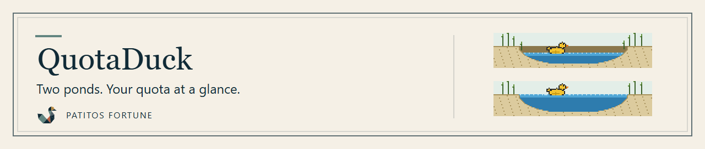

# QuotaDuck

A tiny Windows tray widget that shows your **Claude** and **ChatGPT / Codex** usage side by side: two pixel ponds, one duck each. The water level is how much quota you have *left*; the numbers are always printed beside it.



> **Release candidate `1.0.0-rc.1`, unsigned.** See [Unsigned build and SmartScreen](#unsigned-build-and-smartscreen).
>
> The source on `main` can be ahead of the `1.0.0-rc.1` download: for example the **Copy** buttons and the refreshed card layout are in the source but **not** in the rc.1 ZIP. The release notes describe exactly what the download contains.

[Releases](https://github.com/PatitosFortune/quotaduck/releases) · [Set up Claude](#set-up-claude-one-time) · [Security policy](SECURITY.md) · [Report a vulnerability privately](https://github.com/PatitosFortune/quotaduck/security/advisories/new)

- **Local-first.** No telemetry, no analytics, no updater, no network code of its own. (The Codex quota read starts Codex, which may itself contact its provider; see [Privacy and security notes](#privacy-and-security-notes).)
- **Never spends your quota.** QuotaDuck never sends a prompt or makes a model call. It only reads usage numbers that already exist.
- **No credentials.** It does not read cookies, browser storage, `auth.json` or Claude credentials, needs no admin rights, installs no service and does not start with Windows.
- **Your Claude settings are yours.** QuotaDuck never edits them. It shows you a snippet; you paste it.

## What you see

Click the tray icon (Windows may keep it under the `^` overflow arrow). The flyout has two cards:

| | Claude | Codex |
|---|---|---|
| Source | Claude Code status-line report (a small helper, see setup) | the quota read of the installed Codex app |
| Windows shown | 5-hour and weekly, as reported | 5-hour and weekly, as reported |
| Refresh | none; updates when Claude Code reports | **Refresh** button (at most once a minute) |

Each row shows **% left**, a gauge, when the window resets, and how old the data is. Old data is shown as old (a sleeping duck), and a window that has reset shows "waiting for next report", never a stale number and never 0 %.

## Important limitation: Claude is terminal-driven

Claude usage reaches QuotaDuck **only while Claude Code runs in a terminal** (a normal terminal, or the terminal inside VS Code). In our testing the **VS Code Claude panel** and the **Claude Desktop Code tab** did *not* trigger the status line, so usage from those (and from claude.ai on the web) can stay invisible until a terminal Claude Code session reports again. Until then the Claude pond says "Waiting for Claude Code in a terminal".

## Requirements

- Windows 11, 64-bit (developed and tested on Windows 11).
- The **.NET 10 Desktop Runtime (x64)**. If it is missing, Windows shows a message with an official download link when you start QuotaDuck. Download it from Microsoft only: <https://dotnet.microsoft.com/download/dotnet/10.0> (choose ".NET Desktop Runtime", x64). QuotaDuck does not bundle or update the runtime, so keep it patched (see [Privacy and security notes](#privacy-and-security-notes)).
- For the Codex card: the Codex app installed from the Microsoft Store. QuotaDuck only starts its quota read.
- For the Claude card: Claude Code in a terminal (see setup).

## Install

1. Download `QuotaDuck-<version>-win-x64.zip` and, optionally, check it against `SHA256SUMS.txt`:
   `Get-FileHash .\QuotaDuck-1.0.0-rc.1-win-x64.zip -Algorithm SHA256`
2. Windows marks downloaded files. If you trust the download, right-click the ZIP → **Properties** → tick **Unblock** → OK, *then* extract. (Otherwise Windows may warn on first start.)
3. Extract the `QuotaDuck` folder somewhere you keep for good, for example `%LOCALAPPDATA%\Programs\`, and **keep the folder name `QuotaDuck`**. Your Claude settings will point at the helper inside it, so moving it later means updating that path.
4. Double-click `QuotaDuck.exe`. A duck appears in the tray.

To update, quit QuotaDuck (tray icon → right-click → **Exit**) and replace the folder's files. The path stays the same, so your Claude settings keep working.

## Copy your usage as text

**Not in the `1.0.0-rc.1` download.** The released rc.1 ZIP does not have it; it exists only in the source (`main`) until a later release is built (building from source gives it now). Each provider card has a **Copy** button and there is a **Copy both** button under the cards. They put a plain-text report on the clipboard (remaining and used percentages, reset times, when it was copied, and when each provider's data last changed) that you can paste into an AI assistant or a note. QuotaDuck writes to the clipboard **only when you press one of these buttons**, and what you then paste where is up to you. Copying never refreshes anything and never contacts a provider; stale, expired or missing values are labelled as such, never shown as 0%. Details: `docs/app/APP-SHELL.md`.

## Set up Claude (one time)

Open the flyout. While Claude has never reported, the Claude card shows **Waiting for terminal setup** and a **Set up** button. It opens instructions and a snippet with the real path of `quotaduck-statusline.exe` filled in, with a **Copy** button.

**No status line yet.** Put this in `%USERPROFILE%\.claude\settings.json` (create the file if needed, merge with what is there). The path is shown quoted, so folders with spaces work:

```json
{
  "statusLine": {
    "type": "command",
    "command": "\"C:/Users/you/AppData/Local/Programs/QuotaDuck/quotaduck-statusline.exe\""
  }
}
```

**You already use a status line.** QuotaDuck will not replace it. Add one line to your own script, where it has read Claude's JSON from stdin; your output stays exactly as it was:

```bash
input=$(cat)
echo "$input" | "C:/Users/you/AppData/Local/Programs/QuotaDuck/quotaduck-statusline.exe" --tap
```

Then start Claude Code in a terminal and send a message; numbers appear after its first reply. A project-level `statusLine` shadows the user-level one in that project.

QuotaDuck reads your Claude settings in one narrow way: when you open the flyout while Claude has never reported, it checks whether a top-level `statusLine` key exists in `%USERPROFILE%\.claude\settings.json` so it can show the right instructions. It does not keep the command text and never writes to the file.

## Privacy and security notes

What QuotaDuck does and does not do, stated plainly:

- **The Codex refresh can make Codex contact its provider.** QuotaDuck has no network client of its own. To read Codex quota it starts the installed Codex program (`codex app-server`, found by an absolute, validated path) and sends it only three messages: `initialize`, `initialized` and the quota read. Codex itself may contact its provider to answer that read; that traffic is Codex's, under your own Codex sign-in, and QuotaDuck neither sees nor stores your credentials. It never sends a prompt or makes a model call. Reads happen when you open the flyout for the first time, about every 10 minutes while the flyout stays open, once shortly after a known quota window resets (also while it is hidden), and when you press **Refresh** (at most once a minute); nothing is polled while the flyout is hidden otherwise.
- **Copied usage reports can outlive the paste.** **Copy** and **Copy both** put a plain-text report (percentages, reset times and timestamps only) on the clipboard, and only when you press them. Windows clipboard history (Win+V) and cloud clipboard sync, if you have turned them on, can keep that text, and anything you paste it into keeps it too. Clear the clipboard history if that matters to you.
- **The Claude status-line helper is a program Claude Code runs.** You point your Claude settings at `quotaduck-statusline.exe`, and Claude Code then starts that file every time it refreshes its status line. Keep the `QuotaDuck` folder somewhere only you can change, point the setting only at the real file (the setup snippet fills in the right path), and check the ZIP's SHA-256 before you trust it. If something else could replace that file, it would run as you. The helper only reads the JSON that Claude Code gives it and writes a small local state file under `%LOCALAPPDATA%\QuotaDuck`; QuotaDuck never edits your Claude settings.
- **Signing.** `1.0.0-rc.1` is not code-signed, and there is no commitment that any particular release will be signed. Treat the SHA-256 in the release notes as your integrity check.
- **Keep your .NET Desktop Runtime patched.** The tray app runs on the .NET 10 Desktop Runtime you install, so Microsoft's security updates reach it only if you apply them (Windows Update, or the current installer from Microsoft). QuotaDuck does not update the runtime for you. The helper is a separate Native AOT program with its own copy of the runtime parts it needs. The published `1.0.0-rc.1` helper was built with a .NET toolchain (10.0.12) that a later Microsoft security advisory (a Brotli decoder issue) lists as affected. No path by which QuotaDuck could reach that code has been found, but that is not a proof. The repository now pins the .NET SDK (10.0.403) whose Native AOT toolchain is the patched 10.0.14, so a helper built from this source uses the patched toolchain. The `1.0.0-rc.1` release is unchanged; a release containing the rebuilt helper is pending release verification and owner approval. The assessment and the verification record are in [`docs/security/NU1903-ILCOMPILER-BROTLI.md`](docs/security/NU1903-ILCOMPILER-BROTLI.md).
- **Reporting a problem.** See [`SECURITY.md`](SECURITY.md) and [report a vulnerability privately](https://github.com/PatitosFortune/quotaduck/security/advisories/new). Please do not post vulnerability details in a public issue.

## Uninstall

1. Right-click the tray icon → **Exit**.
2. Delete the `QuotaDuck` folder.
3. Delete the `"statusLine"` entry (or the one `--tap` line) you added to your Claude settings.
4. Optional: delete `%LOCALAPPDATA%\QuotaDuck` (the small local state file the helper keeps).

QuotaDuck writes nothing else: no registry entries, no scheduled tasks, no autostart.

## Unsigned build and SmartScreen

`1.0.0-rc.1` is **not code-signed**. A downloaded copy may show "Windows protected your PC / Unknown publisher" until you unblock it (step 2 above) or choose **More info → Run anyway**. Only do that for a file whose SHA-256 matches the published `SHA256SUMS.txt`. Code signing is not currently committed for any particular release.

## What is in the ZIP

```
QuotaDuck/
  QuotaDuck.exe                  the tray app (framework-dependent)
  QuotaDuck.dll  QuotaDuck.Core.dll  QuotaDuck.Coordinator.dll  QuotaDuck.Codex.dll  QuotaDuck.Art.dll
  QuotaDuck.deps.json  QuotaDuck.runtimeconfig.json
  quotaduck-statusline.exe       the Claude status-line helper (Native AOT, about 1.5 MB)
  README.md  LICENSE  NOTICE
```

## Build from source

Requires the .NET 10 SDK (the repo can use a repo-local one under `.tools/dotnet`). `global.json` pins SDK 10.0.403, the first .NET 10 SDK of this band with the patched .NET 10.0.14 toolchain, which is what builds the Native AOT helper.

```powershell
powershell -File scripts\dotnet.ps1 test QuotaDuck.sln -c Release      # all tests
powershell -File scripts\check-denylist.ps1                           # privacy/safety source scan
powershell -File scripts\verify-bridge-aot.ps1                        # Native AOT bridge checks
powershell -File scripts\release.ps1                                  # builds artifacts\release\QuotaDuck-<version>-win-x64.zip
```

Design notes live in `docs/` (`docs/app`, `docs/bridge`, `docs/codex`, `docs/coordinator`, `docs/art`); project constraints are in `CLAUDE.md`.

The `spikes/` folder holds throw-away prototypes that answered early design questions (Claude status-line behaviour, process launching, Codex discovery, footprint). It is **not** part of the product: it is not in `QuotaDuck.sln`, not built by the commands above, not referenced by `src/`, and not in the release ZIP. You do not need to run anything in it (see `spikes/README.md`).

## Independence

QuotaDuck is an independent implementation. An existing public project in the same space (TokenFish, `pixelsncodes/tokenfish`, which has no licence) was studied as a **reference only**. No code, tests, assets or product text were copied from it; QuotaDuck's structure, art, naming, tests and constants are its own. A no-copy comparison against that project's commit `71ab591947ebabf6b7e03e0344ceb084665477f7` found only generic or provider-contract-dictated overlap (see `docs/spec/QuotaDuck-Phase1-Audit.md` §28).

QuotaDuck is an independent project. It is not affiliated with or endorsed by Anthropic or OpenAI.

## License

Copyright (c) 2026 Patitos Fortune. MIT, see `LICENSE`. Third-party notices (the .NET Native AOT runtime inside the helper) and the statement that all pond and duck artwork is original and generated are in `NOTICE`.
